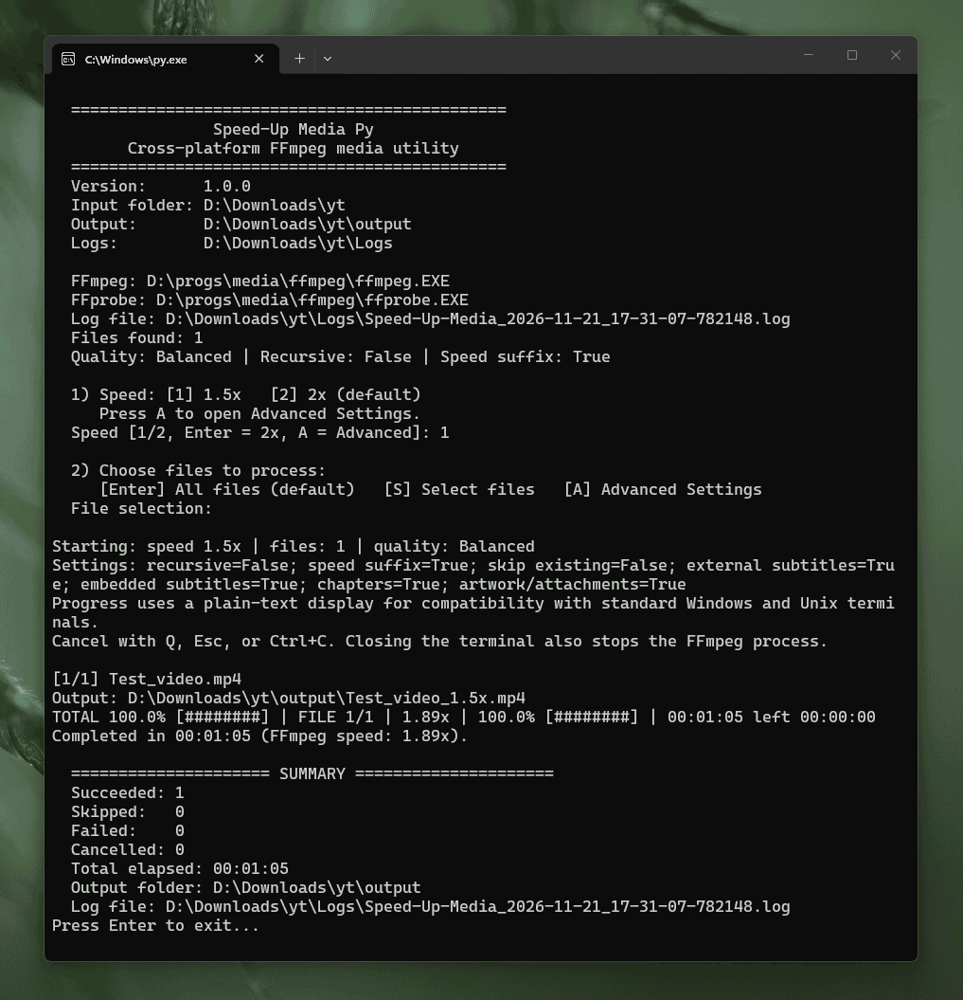

# Speed-Up Media Py

A cross-platform command-line utility that speeds up audio and video files with [FFmpeg](https://ffmpeg.org/). Choose **1.5x** or **2x**, process an entire folder or a selected group of files, and keep the original media untouched.

> **Status:** Initial public release — `v1.0.0`

## Screenshot



## Features

- **Cross-platform:** Windows, Linux, and macOS.
- **No third-party Python packages:** uses only the Python standard library.
- **Two speed presets:** 1.5x and 2x (2x is the default).
- **Flexible file selection:** process all supported files or select individual items using numbers and ranges, for example `1, 3, 6-11`.
- **Optional advanced settings:** quality presets, recursive search, output naming, skip-existing behavior, subtitle/chapter timing, artwork preservation, and opening the output folder.
- **Audio and video support:** handles audio-only files, video-only files, and files containing both audio and video.
- **Multiple streams:** processes all regular video and audio streams found in a media file.
- **Subtitles:** can adjust embedded subtitle timestamps and external `.srt`, `.vtt`, `.ass`, and `.ssa` sidecars.
- **Chapters:** can scale chapter timestamps to match the new duration.
- **Artwork and attachments:** can preserve supported attached cover images and Matroska attachments.
- **Live progress:** shows overall queue progress, current-file progress, FFmpeg speed, elapsed time, and estimated remaining time.
- **Cancellation:** press `Q`, `Esc`, or `Ctrl+C` during processing.
- **Child-process cleanup:** prevents FFmpeg from continuing as an orphan after the application or terminal closes.
- **Safe output:** writes to a temporary file and replaces the final output only after FFmpeg succeeds.
- **Logs:** creates a timestamped UTF-8 log in `Logs/` for every run.
- **Original files are never modified.**

## Requirements

- **Python 3.9 or newer**
- **FFmpeg and FFprobe** (both must be available)

No `pip install` step is required.

### Install FFmpeg

Install an FFmpeg build that includes both `ffmpeg` and `ffprobe`, then either:

1. Add the FFmpeg `bin` directory to your system `PATH`, or
2. Place the FFmpeg executables in the same directory as `speed_up_media.py`.

On Windows, the local executable names should be `ffmpeg.exe` and `ffprobe.exe`. On Linux and macOS, use `ffmpeg` and `ffprobe`.

Examples of package-manager installation commands:

```bash
# macOS (Homebrew)
brew install ffmpeg

# Debian / Ubuntu
sudo apt install ffmpeg

# Fedora
sudo dnf install ffmpeg
```

On Windows, install an FFmpeg build from a trusted distributor and add its `bin` directory to `PATH`.

## Quick start

1. Place `speed_up_media.py` in the folder containing the media files you want to process.
2. Make sure Python, FFmpeg, and FFprobe are available.
3. Open a terminal in that folder and run the command for your operating system.

### Windows terminal or Command Prompt

```bat
py -3 speed_up_media.py
```

Alternatively:

```bat
python speed_up_media.py
```

### Linux and macOS

```bash
python3 speed_up_media.py
```

The script uses its own directory as the input folder, regardless of the terminal's current working directory.

## Basic workflow

The default workflow asks only two questions:

1. **Speed:** choose `1` for 1.5x or `2` for 2x. Press `Enter` for 2x.
2. **Files:** press `Enter` to process all supported files, or press `S` to select files.

When selecting files, the script displays a numbered list. Enter any combination of numbers and inclusive ranges:

```text
1, 3, 6-11
```

Duplicate selections are automatically removed. The selected files are processed in their original list order.

Press `A` at either main prompt to open **Advanced Settings**.

## Advanced settings

| Setting | Default | Description |
|---|---:|---|
| Encoding quality | Balanced | Select Compact, Balanced, or High quality presets. |
| Include subfolders | Off | Search recursively. The `output/` and `Logs/` folders are always excluded. Symbolic links are not followed. |
| Add speed to output filename | On | Adds `_1.5x` or `_2x` before the file extension. |
| Skip existing outputs | Off | Skips a file when its expected output already exists. |
| Scale subtitle timing | On | Adjusts external and embedded subtitle timestamps. When disabled, external sidecars are copied without changing their timing and embedded subtitles are copied as-is. |
| Scale chapter timing | On | Adjusts chapter start/end times to match the accelerated media. |
| Preserve artwork/attachments | On | Copies supported attached cover art and Matroska attachments. |
| Open output folder at end | Off | Opens the `output/` directory when processing finishes. |

## Output structure

The script creates these folders beside `speed_up_media.py`:

```text
Your-Media-Folder/
├── speed_up_media.py
├── ffmpeg.exe              # Optional on Windows when FFmpeg is in PATH
├── ffprobe.exe             # Optional on Windows when FFprobe is in PATH
├── video.mp4
├── audio.flac
├── output/
│   ├── video_2x.mp4
│   └── audio_2x.flac
└── Logs/
    └── Speed-Up-Media_YYYY-MM-DD_HH-MM-SS.log
```

When recursive search is enabled, the relative subfolder structure is reproduced inside `output/`.

## Progress display

The progress display uses plain text and ASCII progress bars rather than ANSI escape sequences. This avoids dependence on terminal color support or virtual-terminal processing.

Example:

```text
TOTAL [####----]  42.0% | FILE 3/7 | 4.8x |  65.0% [#####---] | elapsed 00:01:22 | left 00:00:44 | total ETA 00:03:10
```

The reported `speed` value comes directly from FFmpeg's progress output. Percentages are calculated from the media duration reported by FFprobe. If a file has no usable duration, the file percentage and ETA may be unavailable until processing completes.

### Windows 10 LTSC 21H2 console compatibility

The interface is intentionally designed for the standard Windows console:

- No ANSI color codes or VT-mode configuration is required.
- Progress is drawn with ordinary text and carriage-return updates.
- `Q` and `Esc` key polling uses the Windows `msvcrt` module.
- `Ctrl+C` is handled through Python's signal support.
- FFmpeg runs as a child process assigned to a Windows Job Object with automatic cleanup enabled.

Windows Terminal is supported, but it is not required. The script does not change the console code page or terminal color settings.

## Cancel processing

During a conversion, use any of these controls:

| Key/action | Result |
|---|---|
| `Q` | Stops the current FFmpeg process and the remaining queue. |
| `Esc` | Same as `Q`. |
| `Ctrl+C` | Requests a clean cancellation. |
| Close the terminal/window | The child process is terminated by the platform-specific cleanup mechanism. |

On Windows, FFmpeg is assigned to a Job Object configured with `KILL_ON_JOB_CLOSE`. On Linux and macOS, FFmpeg runs in its own process group, and the application handles termination signals to stop that group. No software can run cleanup code after an uncatchable hard kill, but the operating-system process relationship is used to prevent a detached FFmpeg conversion from being left behind during normal terminal closure.

A cancelled conversion does not replace an existing output file. Its incomplete temporary output is removed during normal cancellation cleanup. If the terminal is forcibly terminated before cleanup can run, a temporary file with `.speedtmp_` in its name may remain in `output/`; it is safe to delete that file manually.

## Supported media types

The input scan recognizes common video/container and audio extensions, including:

- **Video:** MP4, M4V, MOV, QT, MKV, AVI, WebM, WMV, ASF, FLV, F4V, MPEG, MPG, MPE, M1V, M2V, M2TS, MTS, TS, VOB, OGV, 3GP, 3G2, DV, MXF, MPV, and Y4M.
- **Audio:** MP3, MP2, M4A, M4B, M4P, MKA, AAC, FLAC, WAV, WAVE, OGG, OGA, OPUS, WMA, AIFF, AIF, APE, AMR, AC3, DTS, CAF, AU, and RA.

APE, AMR, DTS, and RA extensions are recognized during scanning, but this release does not configure same-container encoders for those formats. Such files are reported as unsupported rather than being written with a misleading extension.
- **External subtitles:** SRT, VTT, ASS, and SSA sidecars matching the media filename.

Recognizing an extension does not guarantee that every codec combination can be encoded into that same container. Available encoders and muxer support depend on the FFmpeg build. Unsupported stream/container combinations are reported in the log.

## How media is processed

- Video timestamps are accelerated with the FFmpeg `setpts` filter and the video is re-encoded using a container-appropriate codec plan.
- Audio is accelerated with the FFmpeg `atempo` filter and re-encoded using a container-appropriate codec plan.
- Regular audio and video streams are explicitly mapped so multi-track files can retain their tracks.
- Embedded subtitles are copied; when subtitle timing scaling is enabled, FFmpeg's `setts` bitstream filter adjusts their timestamps.
- External SRT/VTT/ASS/SSA sidecars are written as UTF-8 with adjusted timestamps. UTF-8, UTF-16 BOM files, and common CP1251 legacy files are recognized.
- Chapters are written through FFmpeg metadata input with scaled start/end timestamps.
- Attached cover art and Matroska attachments are copied where supported.
- Metadata is preserved where FFmpeg and the destination container allow it.

The Compact, Balanced, and High presets influence codec quality/bitrate settings. They do not guarantee a particular output size or quality across different codecs and source material.

## Run the helper tests

The project includes a small test suite using Python's built-in `unittest` module:

```bash
python -m unittest discover -s tests -v
```

## Logs and troubleshooting

Each run creates a new UTF-8 log file in `Logs/`. FFmpeg warnings/errors and processing details are written there so the progress display remains readable.

**FFmpeg or FFprobe not found**  
Add the FFmpeg `bin` directory to `PATH`, or place both executables beside the script.

**A file fails to convert**  
Check the latest log in `Logs/`. The error may indicate a missing encoder in the FFmpeg build, an unsupported container/codec combination, or a damaged input file.

**Subtitle timing looks wrong**  
The script adjusts standard SRT/VTT timestamps and ASS/SSA dialogue start/end fields. Complex subtitle formats with custom timing behavior may need manual review.

**Progress percentage is unavailable**  
Some media files do not expose a reliable duration. FFmpeg still processes them, but percentage and ETA estimates cannot be calculated reliably.

## Project layout

```text
Speed-Up-Media-Py/
├── speed_up_media.py
├── README.md
├── RELEASE_NOTES.md
├── .gitignore
├── tests/
│   └── test_helpers.py
└── docs/
    └── screenshot.png       # Add your terminal screenshot here
```

## Acknowledgements

[FFmpeg](https://ffmpeg.org/) — media probing, filtering, encoding, and remuxing.

The code was written using web version of ChatGPT 😁.

## License

[MIT](LICENSE)
